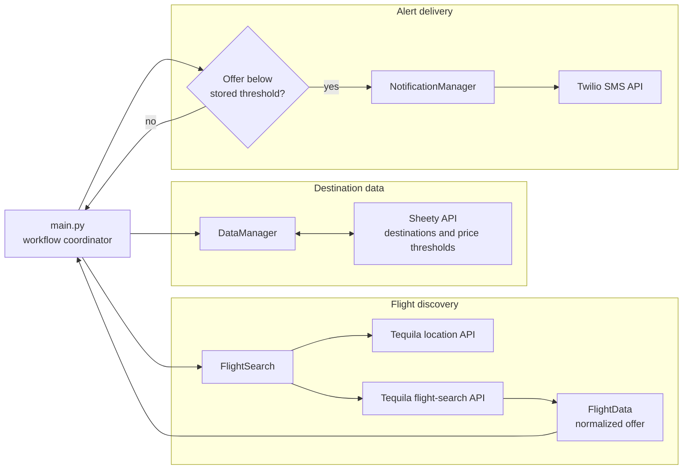

# Skyscout

**Flight-fare monitoring and notification workflow**

## Overview

Skyscout is a Python application that reads travel destinations and price targets from a remote sheet, checks flight offers through an external flight-search provider, and sends SMS notifications when it finds offers below the configured thresholds. It separates destination management, flight retrieval, flight-data representation, and notifications into modules.

### Why it matters

Flight-fare monitoring requires coordinating multiple providers and converting provider responses into actionable alerts. Skyscout shows how a small application can combine remote configuration, travel search, filtering, and messaging.

## Key capabilities

- Loads destinations and desired prices from a remote sheet using Sheety.
- Resolves destination IATA codes when they are missing.
- Requests flight-search data for configured routes and travel windows.
- Compares returned fares with destination-specific price targets.
- Formats flight data for use in notification messages.
- Uses Twilio for SMS alerts when qualifying offers are found.

## System architecture



### How the workflow operates

The main script initializes the sheet, flight-search, and notification clients. It retrieves the destinations, fills in missing airport codes, and requests offers over the configured travel window. The matching logic checks prices against the sheet-defined threshold and invokes the notification adapter for a qualifying itinerary.

Provider credentials, sender numbers, and recipient configuration are external integration concerns. Test with your own authorized provider accounts before enabling remote updates or text messages.

## Technology stack

| Technology | Purpose |
| --- | --- |
| **Python** | Application orchestration and data models |
| **Requests / HTTP APIs** | External service requests |
| **Sheety** | Destination and threshold storage |
| **Flight-search API** | Airport lookup and flight availability data |
| **Twilio** | SMS delivery |

## Repository structure

```text
main.py                  Orchestration and price checks
data_manager.py          Destination-sheet integration
flight_search.py         Airport-code and flight-search integration
flight_data.py           Flight data representation
notification_manager.py  SMS delivery interface
```

## Getting started

```bash
python3 -m venv .venv
source .venv/bin/activate
pip install requests twilio
# Review service settings and configure authorized API access.
python main.py
```

## Notes and prerequisites

The script may update the remote destination sheet and send SMS messages. Review its integration settings before execution. An earlier audit found credential-like values in repository history; the separate security work should be completed and any exposed credentials rotated. Avoid publishing live keys or phone numbers.
