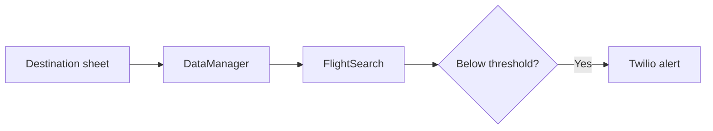

  

<strong>A modular Python workflow that checks flight offers against destination price thresholds and prepares SMS alerts.</strong>

## Overview

A modular Python workflow that checks flight offers against destination price thresholds and prepares SMS alerts.

### Why it matters

Skyscout demonstrates clean API orchestration across a destination sheet, flight search, normalized offer data, and notification delivery.

## Key features

- Destination and threshold management through Sheety
- Airport-code lookup and flight-offer search
- Normalized flight data objects
- Twilio-backed notification delivery

## Architecture

## Technology stack

**python** · **requests** · **twilio**

## Getting started

Create an isolated Python environment, install the imported packages, and provide your own authorized provider configuration. Review `main.py` before running because it can update remote data and send messages.
